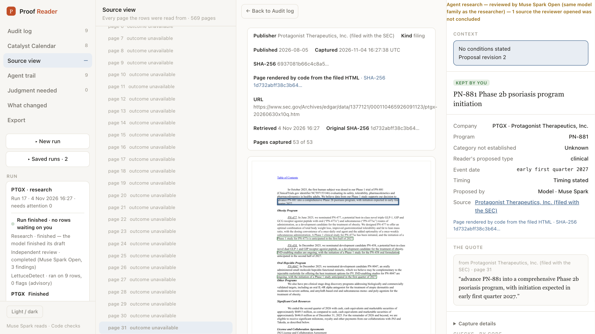
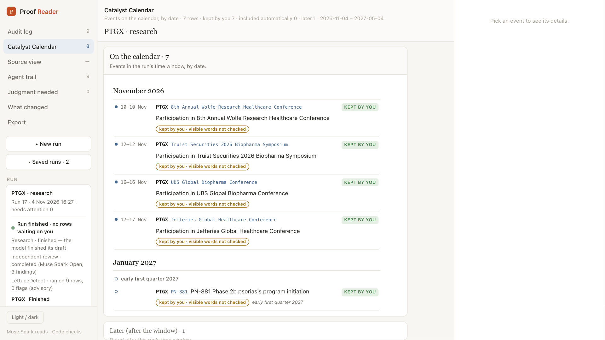

# Proof Reader

I research investment catalysts for biotech companies: trial starts and readouts, regulatory decisions, launches and investor events for the next six months. I do this with several AI models, and I review their claims against the sources they cite. For the Meta Global AI Developer Hackathon 2026 (Indie track, "Build for Your World"), I tried to automate that workflow with Meta's models. Proof Reader is the result.

This README is an honest after-action report: what worked, what did not, and why.

**Status:** the workflow is demonstrated in two live PTGX runs. Research recall, repeatability and autonomous use have not been validated. The demonstrated workflow keeps a person in control.

**Demo video:** https://youtu.be/oXevxrh5JCg



## How it works

1. **Muse Spark** (Meta Model API) works as a research agent for one company. It searches the web (Brave Search), captures pages, and proposes each event with an exact quote from a captured page.
2. **Code** then runs mechanical checks on each proposal: is the quote on the captured page, is the citation located, is the date printed in the quote, and does the source follow the source rule. Each check is recorded as passed, failed or not checked. These checks do not establish whether an event is true, current or complete.
3. **Muse Spark Open** (Meta's open-weight model, served on Baseten as `meta-models/muse-spark-open-1026`) reviews the rows. It looks for stale guidance and missing events, and can fetch sources itself. DeepSeek V4 Pro is a fallback only if Muse Spark Open is unavailable. The reviewer is from the same model family as the researcher, and the app says so: it is a second look, not independent verification.
4. **Muse Wonder** (Meta Model API) proposes a resolution for each disagreement it is sent. Its proposal does not accept a row; that decision belongs to the person.
5. **LettuceDetect**, a model-based support check, may flag wording for a person to inspect. No flag is not proof of correctness.
6. **A person reviews** each row that has a failed check or a reviewer finding, and keeps, fixes or removes it, by click or by voice (**Muse Voice Transcribe**). Voice only pre-fills; nothing is saved until the person clicks. A row with no failed check and no reviewer finding is placed on the calendar automatically. It is labelled "not reviewed by you" until a person decides it, and the person can still keep or remove it.
7. The **calendar** and the **PDF and Word reports** are built by code from the saved run. Each row shows whether a person kept it or it was placed automatically.

The research brief is one visible, editable box. The exact request sent to the models is frozen and saved with each run.



## Run it

### Saved-run demo (earlier page-reading version)

The no-key demo bundled in the repo demonstrates the earlier page-reading workflow. After installation, it requires no API keys or paid model calls.

```sh
python3 -m venv .venv && .venv/bin/pip install -r requirements.txt
.venv/bin/python -m runs.demo
```

The app opens at <http://127.0.0.1:8777/#/ptgx-r5/audit>. Three clicks:

1. In **Audit log**, click the row **PN-8047** (Q1 2027).
2. Read its checks, then click its source link to see the quote boxed on the captured page.
3. Open **Catalyst Calendar** to see the result, and **Export** for its PDF and Word reports.

More detail is in [docs/BUILD_NOTES_PAGE_READER.md](docs/BUILD_NOTES_PAGE_READER.md).

### Runs 17 and 18 (the research runs in the video)

They are too large for the repository (160 MB and 96 MB zipped), so they are attached to the [demo-runs release](https://github.com/CVA71actual/proof-reader-hackathon/releases/tag/demo-runs). Download `proof-reader-run-17.zip` and/or `proof-reader-run-18.zip`, unzip them into the `runs/` folder, and open one. No key or paid call is needed:

```sh
.venv/bin/python -m runs.demo --run run-17
```

The app opens at <http://127.0.0.1:8777/#/run-17/audit>. The Agent trail shows every search, capture, proposal, check and review finding. The Catalyst Calendar and Export show the result.

### Live research (keys needed; new runs cost money)

Put your keys in `~/.config/proof-reader/env`, one per line, each as `NAME="value"`. Keep credentials outside the repository, and do not commit the environment file.
- `MODEL_API_KEY`: the Meta Model API key, for Muse Spark, Muse Wonder and Muse Voice Transcribe.
- `BASETEN_API_KEY`: Muse Spark Open.
- `BRAVE_API_KEY`: Brave Search.
- `SEC_USER_AGENT`: your name and email, which SEC EDGAR requires on every request. Quote it, for example `SEC_USER_AGENT="Jane Doe jane@example.com"`.

You also need Google Chrome installed: captured pages are rendered with headless Chrome. Install first, as in the saved-run demo (`python3 -m venv .venv && .venv/bin/pip install -r requirements.txt`).

Then:

```sh
set -a; . ~/.config/proof-reader/env; set +a
.venv/bin/python -m uvicorn server.app:app --port 8790
```

Open <http://127.0.0.1:8790> and click **New run**. Tick **PTGX** under "Previously captured" (or type tickers and click **Prepare tickers**). Set a spending limit and a turn limit, and review the brief. Then click **Run now**. The run card shows progress; the Agent trail fills in as it goes. Recorded costs for the two featured runs were $4.19 and $2.79. Costs vary with settings and research length. LettuceDetect is optional: set `LETTUCE_PYTHON` and `LETTUCE_WEIGHTS_PATH` to a local install of `KRLabsOrg/lettucedect-v2-mmbert-base`.


## Demo runs (PTGX, Protagonist Therapeutics, 4 Nov 2026)

**Two versions:** the video shows the current research version (runs 17 and 18), which you can download from the release linked under "Run it". The demo bundled in the repo uses saved runs from the earlier page-reading version.

- **Run 17** (build b3eaa46):
  - Research: 207 turns, 27 sources captured, 9 rows generated, including one placed after the window and one the researcher excluded as already launched.
  - Review: Muse Spark Open assessed all 9 rows and made 3 findings. Code closed the review at its turn limit, and one source the reviewer fetched was left unconcluded.
  - LettuceDetect: 0 flags.
  - Recorded spend: $4.19.
  - I kept 8 rows and removed 1. The PDF and Word reports contain exactly the 8 kept rows.
- **Run 18** (same build, recorded live for the video):
  - 109 turns, 8 rows.
  - Review complete with 4 findings, each about a dropped "expected" or "anticipated" qualifier.
  - Recorded spend: $2.79.

## What helped, and why

The mechanical parts and the saved records:
- exact quotes tied to captured, fingerprinted pages
- recorded check results
- spending and turn limits
- stage labels that say what actually ran
- one saved request per run

Explicit instructions also helped. After I specified "each conference is its own event", four investor conferences appeared as separate rows rather than one grouped row. Other settings also changed, so this was an observation, not a controlled test of that instruction.

Saved records helped me investigate failures. These parts also needed fixes along the way. For example, an early run let the same conference be accepted twice as two separate rows. Code can reject a repeated action on one row, but semantic duplicates across different rows still need detection and review.

## What remained unreliable, and why

**Research coverage and judgment.** On an exploratory list of 15 candidate items for one company, my runs found roughly 3 to 11. That list is not a validated recall score. Broader, longer runs often found more, but my tests did not isolate the effects of instructions, tools or limits. Run 17 missed partner investor events.

The reviewer was uneven. In run 17 it flagged stale launch guidance on a row the researcher had already excluded, and it wrongly asked to add a past approval.

## Why LLMs were hard to build on

My experiments exposed four practical risks in this implementation:

1. **Models did not reliably follow instructions.** Across runs, the reviewer was told to give every row a verdict and then finish. Instead it looped for 92 calls, replied in prose instead of calling tools, filed findings without verdicts, and left sources it had opened unconcluded. Code either recorded the review as incomplete, or closed it under explicit completion rules with the remaining limitations kept.
2. **Models spent their effort unevenly.** In run 17, 31 of 98 searches went to one question (whether one drug had already launched), and the same two Takeda pages were captured 6 and 5 times. Partner investor events got little attention and were missed.
3. **Results varied between runs.** The reviewer caught stale guidance in one run and missed similar issues in another. Inputs and settings also differed.
4. **Passing tests did not establish live quality.** More than 3,000 passing tests did not represent the failures that live runs exposed. Live runs, and audits against the sources afterwards, found them.

What I would keep: code that constrains what can be accepted and preserves evidence, honest stage labels, and a person deciding. Checking a model's format does not make its judgment correct. Models explore, code checks what can be checked mechanically, and a person judges.

## How it was built

I directed a team of AI models, each with a fixed role:

- **Codex app (GPT-6 Astra)**: design and coding on the toughest problems, plus independent audits and acceptance checks.
- **Claude app (Fable 5.1)**: coding and managing the other coders: integration, reviews, merges and the project record.
- **Kimi app**: the app's screens and visual design.
- **Terminal coders**: Kimi, Grok, Claude Opus 5.5 (with Haiku for quick asynchronous checks) and Cursor.
- **Grok Bot**: the dedicated red teamer, challenging each build; it also ran the coding seats and handled helper tasks.
- **Devin bot**: patrolled the repository for errors.
- **Manus**: oversight of the code, analysis and patterns across runs.

The working rules:
- No model approved its own work. Every change needed a review from a different model, plus the automated tests.
- I decided what merged.
- Any change to how the models were instructed got a cheap live trial run before a full run.
- Reviews and decisions were written to a project record.

The build taught the same lesson as the product: the models wrote most of the code, but checks at the edges (tests, review by a different model, a person deciding) caught what they missed.

## Meta products used

- **Muse Spark** through the Meta Model API: the research agent.
- **Muse Spark Open**, open weights on Baseten: the reviewer.
- **Muse Wonder** through the Meta Model API: proposed resolutions for disagreements.
- **Muse Voice Transcribe**: spoken decisions.

Also tried and not in the final path:
- Muse Spark Open reading slide-style pages as images
- SAM 3.1 for text regions
- letting the researcher call the checks itself

Not used: Muse Code.

## Built during the hackathon

This repository was created on 14 Oct 2026 with only a placeholder README (one commit). All product code was written during the hackathon, from 26 Oct to 4 Nov 2026, and the full commit history is included. I built it with the AI team described under "How it was built".

## Licence

MIT. See [LICENSE](LICENSE).
